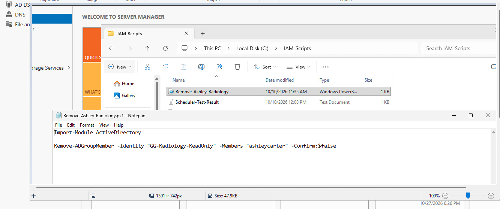
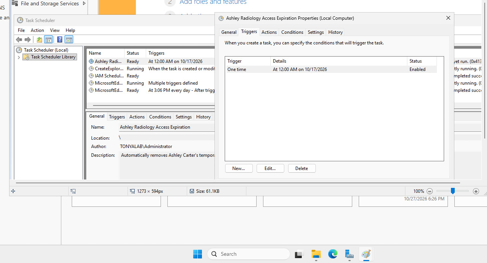
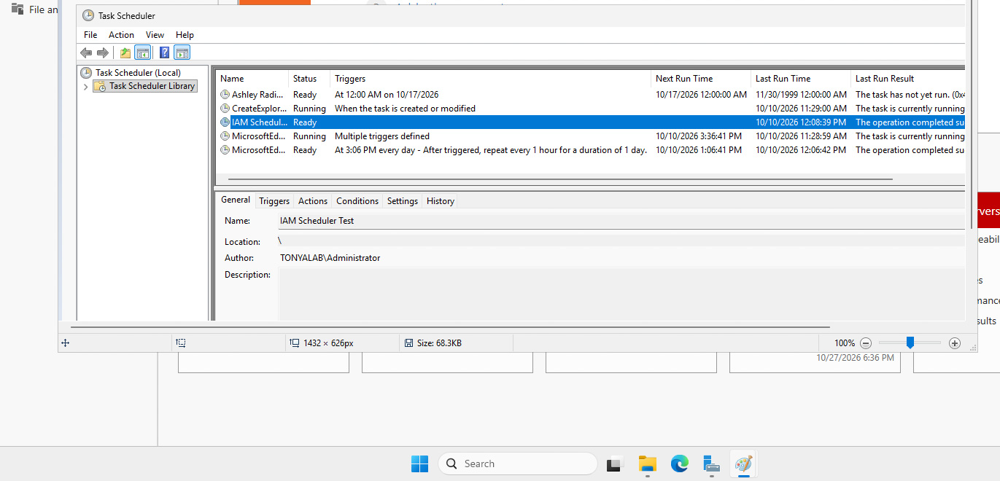

# Healthcare Employee Offboarding | Active Directory

## Project Overview
This project documents an employee offboarding scenario in TonyaLab, an independent healthcare-themed Active Directory home lab. The objective was to revoke a departing employee's access and verify the results.

## Lab Environment
- Oracle VirtualBox
- Windows Server 2022 (DC01)
- Windows 11 Enterprise client
- Active Directory domain: `tonyalab.local`
- Active Directory Users and Computers (ADUC)
- Windows Event Viewer

## Scenario
David Thompson, a fictional employee assigned to the Laboratory department, was selected for a simulated employee termination. The goal was to disable his account, remove unnecessary security group memberships, and investigate whether the account could still access a domain-joined workstation.

## Objectives
- Disable the departing employee's Active Directory account.
- Remove security group memberships.
- Test access after account deactivation.
- Review Windows security events to understand authentication behavior.

## Implementation
1. Located David Thompson's user account in Active Directory Users and Computers.
2. Disabled the account to prevent further domain authentication.
3. Removed assigned security group memberships as part of the offboarding process.
4. Investigated a Windows sign-in event associated with cached credentials.
5. Reviewed Windows Security Event ID 4624, Logon Type 11, indicating cached interactive logon.
6. Performed an additional sign-in test and observed that access was denied.

## Security Concepts Demonstrated
- Identity lifecycle management
- Account deprovisioning
- Access revocation
- Security group administration
- Authentication event analysis
- Cached credentials and endpoint access considerations

## Findings and Lessons Learned
Disabling an Active Directory account is a critical offboarding step, but cached interactive logon behavior must also be understood. Event ID 4624 with Logon Type 11 can indicate a successful sign-in using locally cached domain credentials, rather than fresh authentication against a domain controller.

This exercise reinforced the importance of validating offboarding outcomes and distinguishing domain account status from endpoint sign-in behavior.

## Lab Evidence — Access Revocation

### 1. PowerShell Access Revocation

Documented a PowerShell command for removing a fictional healthcare employee from an Active Directory security group. This illustrates a method for revoking departmental access.

### 2. Scheduled Access Expiration

Documented a scheduled access-expiration exercise designed to limit an employee's access after a defined period.

### 3. Scheduled Task Test

Captured a scheduled-task test associated with the automated access-management exercise.

## Evidence Scope

These screenshots demonstrate selected access-revocation and automation exercises. The separate full employee offboarding scenario, including account disablement, group removal verification, and Windows sign-in investigation, requires its own supporting evidence.

## Project Takeaway
This project provided hands-on practice with employee offboarding, access revocation, and troubleshooting authentication behavior in an Active Directory environment.

*All accounts and scenarios are fictional. This is an independent educational home-lab project.*
