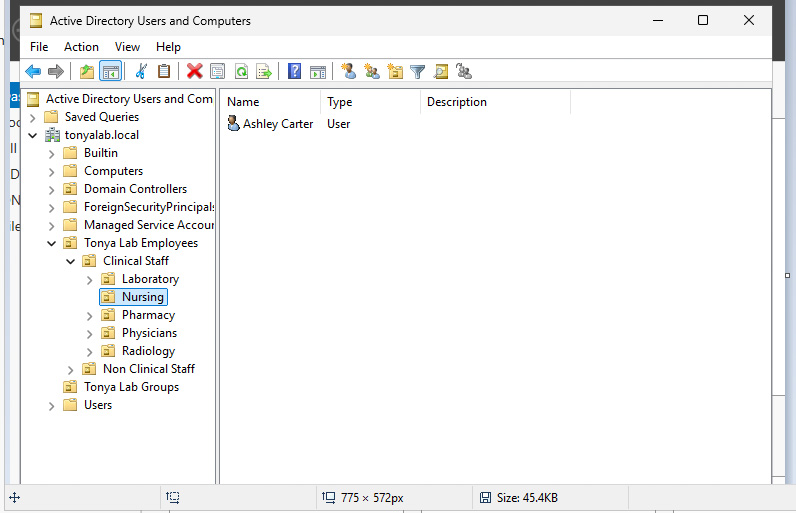
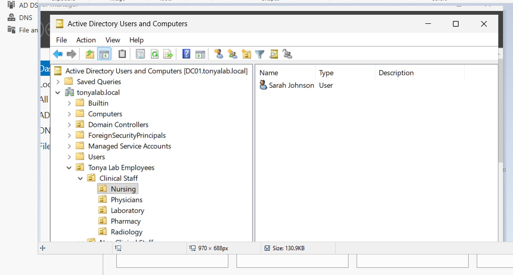
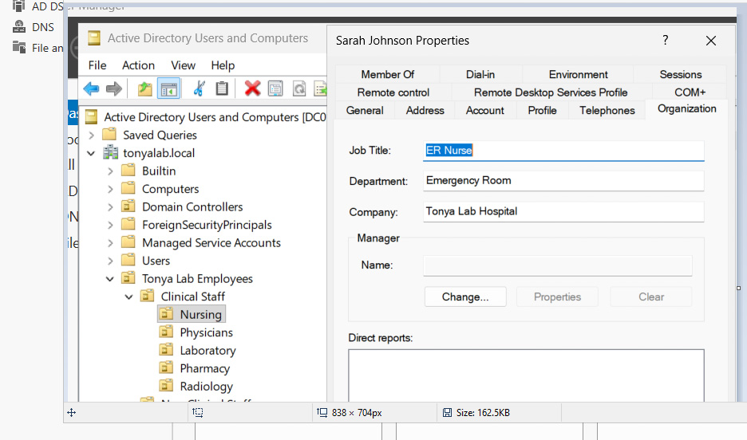
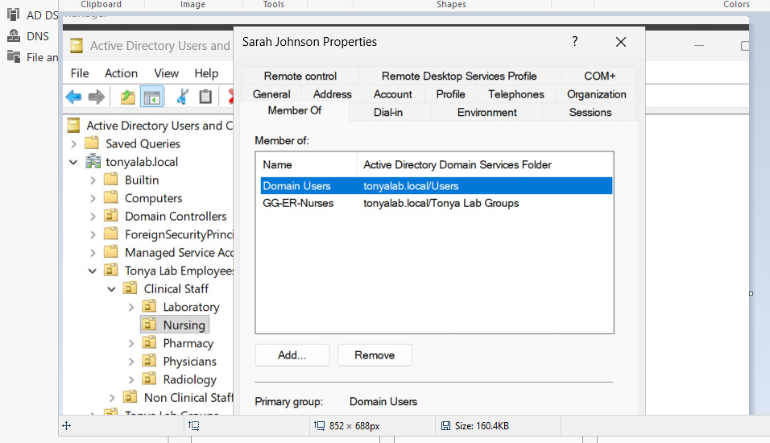

# Healthcare Employee Onboarding | Active Directory

## Project Overview
This project documents an employee onboarding workflow in TonyaLab, an independent healthcare-themed Active Directory home lab. The objective was to create domain user accounts and assign access based on simulated employee job responsibilities.

## Lab Environment
- Oracle VirtualBox
- Windows Server 2022 (DC01)
- Windows 11 Enterprise client
- Active Directory domain: `tonyalab.local`
- Active Directory Users and Computers (ADUC)

## Objectives
- Create new employee accounts in Active Directory.
- Organize accounts into department-specific Organizational Units (OUs).
- Assign security group memberships based on job responsibilities.
- Apply role-based access control (RBAC) principles.
- Review user and group configurations.

## Implementation
1. Created healthcare department OUs to organize employee accounts.
2. Created fictional employee accounts representing clinical staff.
3. Assigned accounts to appropriate security groups, including emergency room and laboratory groups.
4. Configured departmental shared-folder permissions using security groups.
5. Reviewed account and group configurations in Active Directory Users and Computers.

## Security Concepts Demonstrated
- Identity lifecycle management
- User provisioning
- Role-based access control (RBAC)
- Least-privilege access
- Security group administration

## Lab Evidence — Screenshots

### 1. Employee Account Creation

Created a fictional healthcare employee account in the Nursing organizational unit.

### 2. Employee Organizational Unit Placement

Organized the employee account within the appropriate department in Active Directory.

### 3. Employee Attributes

Configured job title, department, and company information for a fictional healthcare employee.

### 4. Security Group Membership

Assigned the employee to the GG-ER-Nurses security group to support role-based access management.

## Project Takeaway
This exercise provided hands-on practice with foundational IAM administration tasks in a simulated healthcare organization. It reinforced how user accounts, organizational structure, and security groups support consistent access management.

*This is an independent educational home-lab project. All employee identities and organizational scenarios are fictional.*

