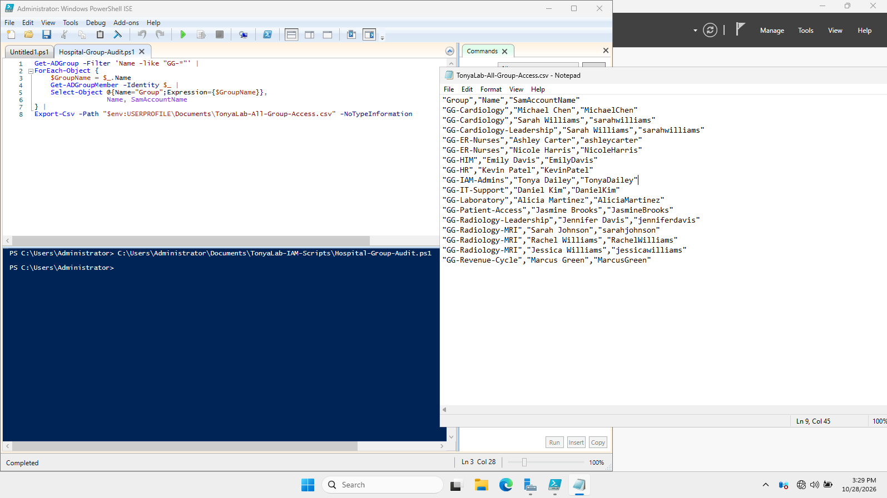
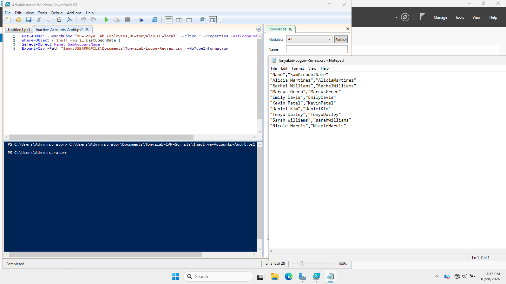
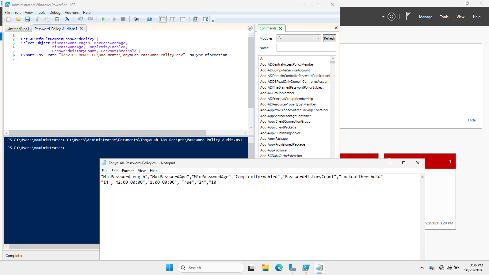

# PowerShell Security Auditing | Active Directory

## Project Overview
This project documents PowerShell-based security auditing exercises performed in TonyaLab, an independent healthcare-themed Active Directory home lab. The objective was to practice reviewing account status, group memberships, inactive accounts, and domain password policies.

## Lab Environment
- Oracle VirtualBox
- Windows Server 2022 (DC01)
- Active Directory Domain Services
- Active Directory PowerShell module
- Domain: `tonyalab.local`

## Objectives
- Identify disabled Active Directory accounts.
- Review potentially inactive user accounts.
- Audit security group memberships.
- Inspect domain password and account lockout policies.
- Develop practical PowerShell auditing skills.

## Auditing Exercises

### 1. Disabled Account Audit
Created and tested a PowerShell script to identify disabled domain accounts.

Script: `Disabled-Accounts-Audit.ps1`

### 2. Inactive Account Audit
Practiced identifying potentially inactive user accounts using Active Directory account activity information.

Script: `Inactive-Accounts-Audit.ps1`

### 3. Security Group Membership Audit
Reviewed departmental security groups and their members to support access reviews.

Script: `Hospital-Group-Audit.ps1`

### 4. Password Policy Audit
Reviewed the domain's password and account lockout settings, including password length requirements and lockout thresholds.

Script: `Password-Policy-Audit.ps1`

## Security Concepts Demonstrated
- Identity governance and access reviews
- Account lifecycle monitoring
- Security group auditing
- Password policy assessment
- PowerShell automation
- Least-privilege access management

The following screenshots document PowerShell security auditing performed in the TonyaLab Active Directory environment.

### Disabled Accounts Audit

### Hospital Group Access Audit

### Inactive Accounts Audit

### Password Policy Audit

## Project Takeaway
These exercises provided hands-on practice using PowerShell to collect and review Active Directory security information. They reinforced the value of repeatable auditing procedures for IAM administration.

*All exercises were completed in an independent educational home lab using fictional identities.*
