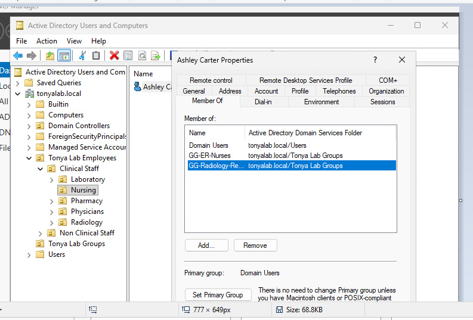
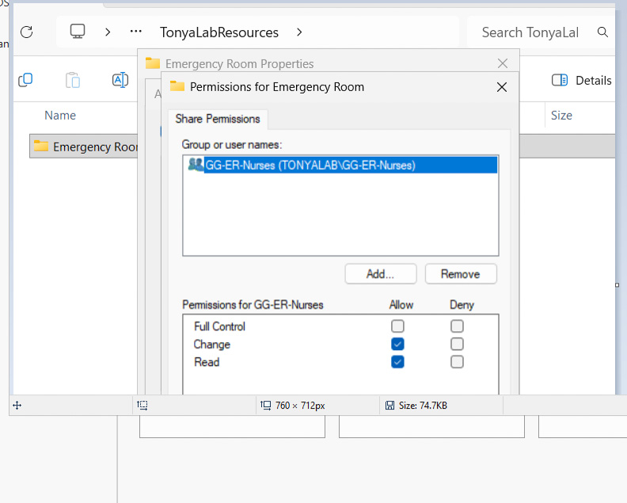
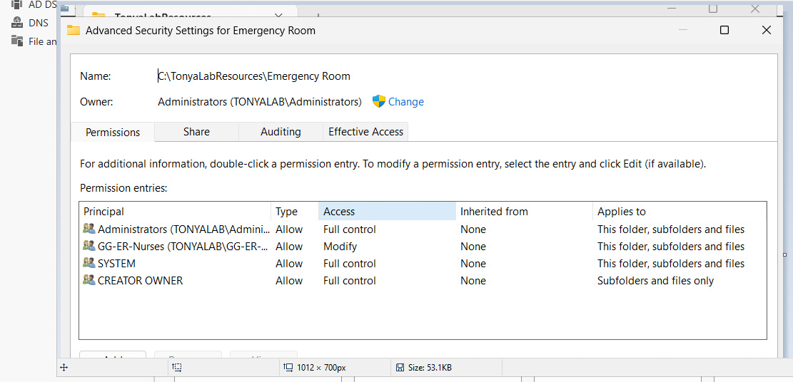
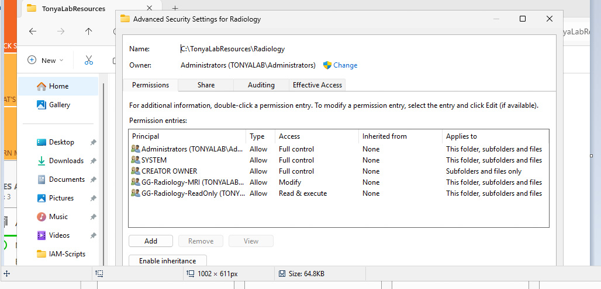
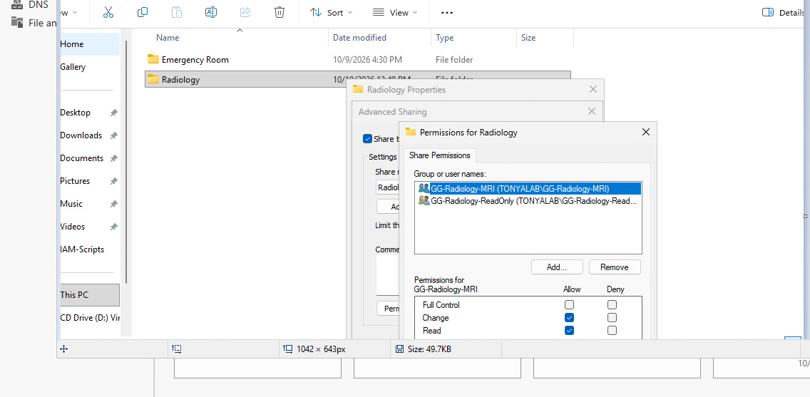
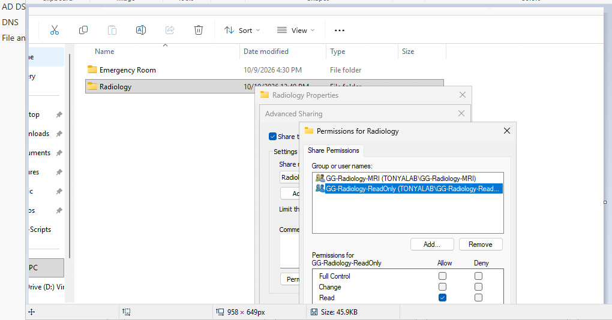

# Role-Based Access Control (RBAC) | Active Directory

## Project Overview
This project demonstrates role-based access management in TonyaLab, an independent healthcare-themed Active Directory home lab. The objective was to organize users by department and control access to shared resources using security groups.

## Lab Environment
- Oracle VirtualBox
- Windows Server 2022 (DC01)
- Windows 11 Enterprise
- Active Directory domain: `tonyalab.local`
- Active Directory Users and Computers (ADUC)
- Windows file sharing and permissions

## Objectives
- Organize employees into departmental Organizational Units (OUs).
- Create security groups representing healthcare job roles.
- Assign users to groups based on their responsibilities.
- Configure departmental shared-folder permissions.
- Practice least-privilege access management.

## Implementation
1. Created OUs representing healthcare departments, including Nursing, Physicians, Laboratory, Pharmacy, and Radiology.
2. Created role-based security groups, including `GG-ER-Nurses`, `GG-ER-Physicians`, `GG-Laboratory`, and `GG-Radiology-ReadOnly`.
3. Assigned fictional employees to groups according to their simulated job responsibilities.
4. Configured access to departmental shared folders using security group permissions.
5. Used read-only group membership to represent limited access requirements across departments.
6. Reviewed group memberships and folder permission settings in the lab.

## Security Concepts Demonstrated
- Role-Based Access Control (RBAC)
- Principle of least privilege
- Active Directory security groups
- Group-based access administration
- File share permissions
- Separation of departmental responsibilities

## Lab Evidence — Screenshots

### 1. Active Directory Security Group Membership

Reviewed security group memberships for a fictional healthcare employee to demonstrate role-based access assignments.

### 2. Emergency Room Share Permissions

Configured shared-folder permissions for Emergency Room resources using Active Directory security groups.

### 3. NTFS Folder Permissions

Reviewed Windows NTFS permissions to demonstrate how access to departmental folders is controlled.

### 4. Radiology NTFS Permissions

Configured departmental file-system permissions to support role-based access and least-privilege principles.

### 5. Radiology Modify Access

Configured Change and Read share permissions for a Radiology security group requiring modification access.

### 6. Radiology Read-Only Access

Configured Read-only share permissions for a Radiology security group requiring limited access.

## Security Takeaway

This project demonstrates how Active Directory security groups, NTFS permissions, and shared-folder permissions can be combined to manage departmental access in a simulated healthcare environment.

## Project Takeaway
This exercise demonstrated how security groups can simplify access management and help enforce consistent permissions across a simulated healthcare organization.

*This is an independent educational home-lab project using fictional employees and departments.*
